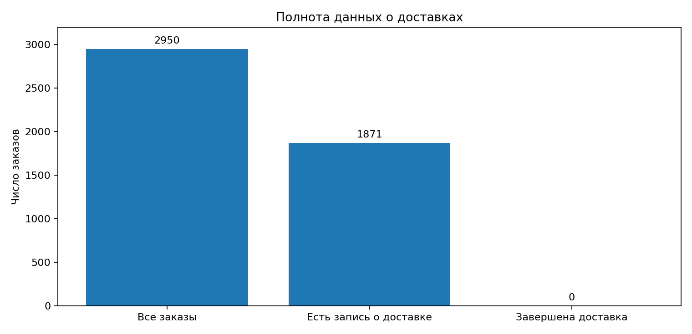

# Прогноз времени доставки: подготовка A/B-теста

**Как проверить влияние нового ETA на заказы быстрой доставки?**

В мобильном приложении для быстрой доставки всем пользователям показывали одинаковый интервал **20-60 минут**. Новый алгоритм рассчитывает интервал с учётом условий доставки. Исследование посвящено тому, какие показатели нужно сравнить, чтобы принять решение о его внедрении, и какие данные необходимы для достоверного теста.

## Что показал анализ данных

| Показатель исторической выборки | Результат |
|---|---:|
| Заказы | **2 950** |
| Заказы с данными о доставке | **1 871** |
| Заказы с хотя бы одной завершённой доставкой | **1 175 (62,8% от заказов с известным статусом)** |
| Заказы с несколькими записями доставки | **815** |
| Сессии с некорректным временем начала | **42** |

Главная проблема качества данных: несколько строк доставки могут относиться к одному заказу. Кроме того, в исторической базе нет времени фактической доставки **в минутах**, показанного клиенту ETA и меток тестовой/контрольной группы. Поэтому на этих данных нельзя сделать вывод об эффективности нового алгоритма.

## Предложенный эксперимент

**Контрольная группа** видит прежние 20-60 минут; **тестовая** – прогноз модели. Пользователей распределяем случайно **50/50** до первого показа интервала, группу закрепляем за `customer_id`.

**Основная метрика** – конверсия из показа ETA в оформление заказа быстрой доставки. Дополнительно отслеживаем выполненные заказы, долю доставок позже обещанного времени и средний чек. Для анализа нужны события показа ETA, фактическое время доставки, версия прогноза и корректная идентификация группы. До запуска следует определить длительность эксперимента и необходимую выборку.

**Результат исследования:** сформирован проверяемый дизайн эксперимента, описаны ключевые метрики и выявлены ограничения данных, которые необходимо устранить до принятия продуктового решения.

## Материалы

- [Анализ данных и дизайн A/B-теста](eta_analysis.ipynb) – ноутбук с расчётами, контролем качества и постановкой эксперимента.
- `eta_data.sqlite` – шесть связанных таблиц: пользователи (без имён и контактов), сессии, заказы, товары и доставки.

Ноутбук выполняется в Jupyter из корня репозитория. Требуются `pandas`, `numpy`, `matplotlib`.
